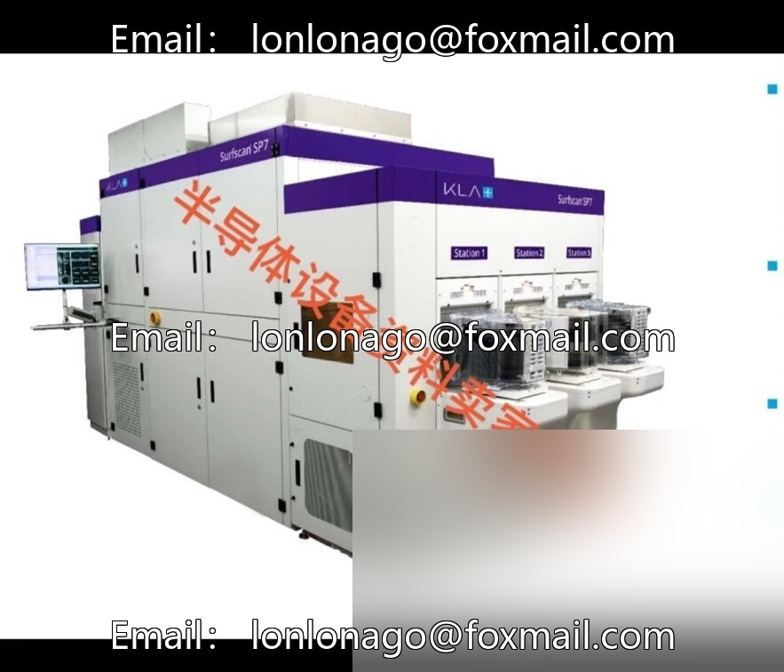
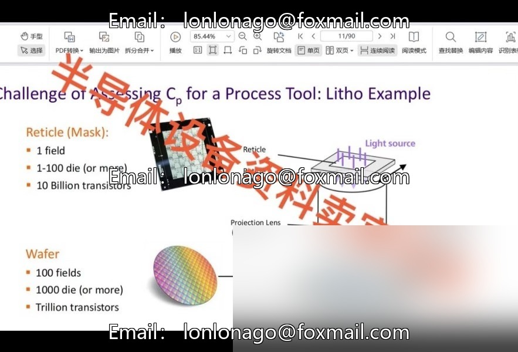
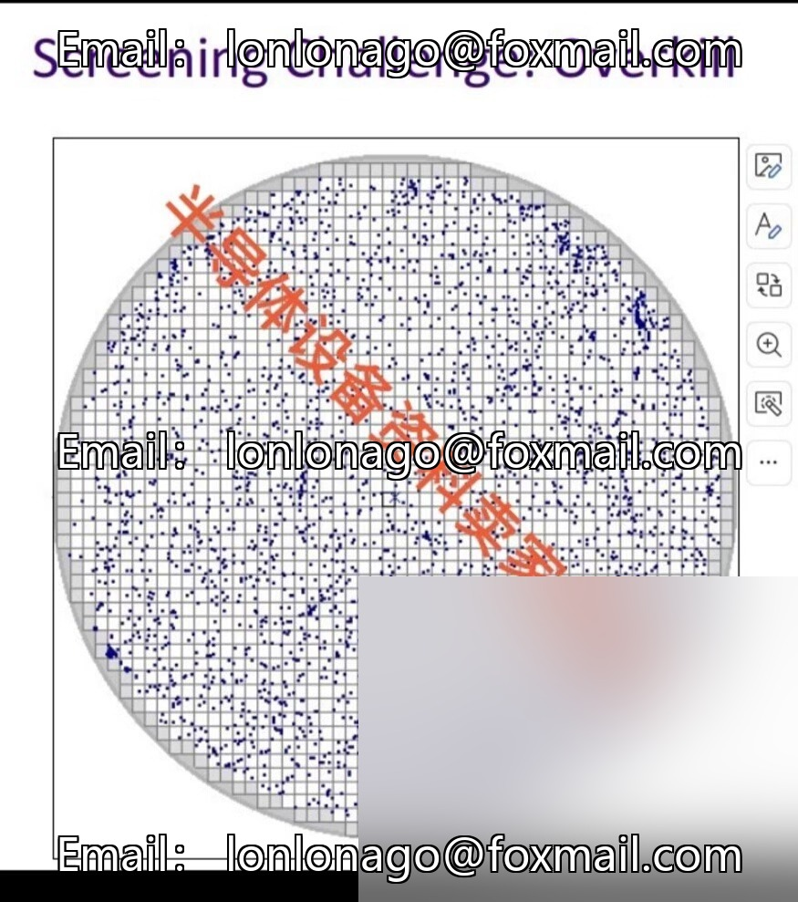
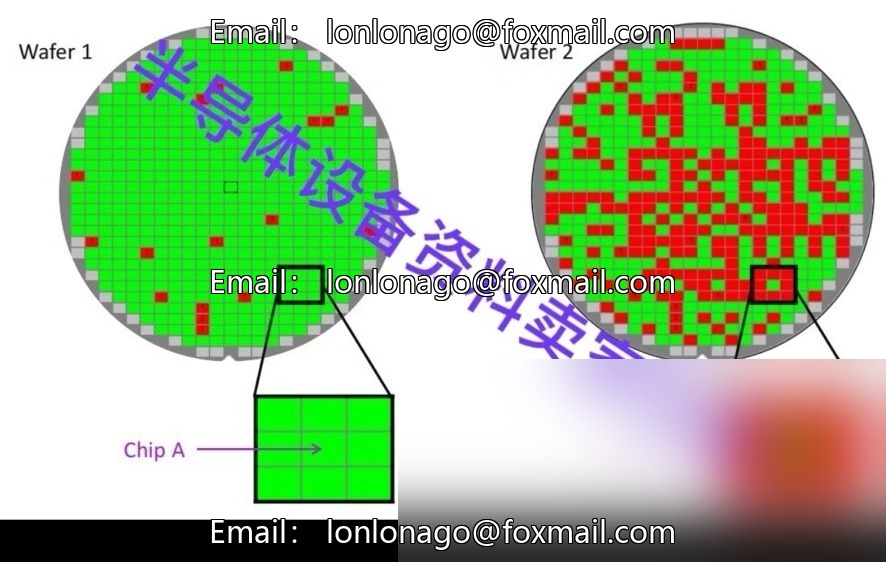
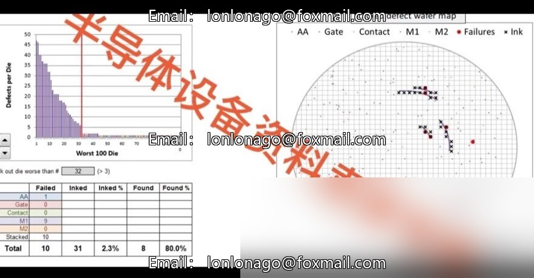

# KLA wafer detection technology: methods for researching and equipment for reducing defects in wafers and chips

## Body

KLA wafer inspection technology: research on methods to reduce defects and an introduction to equipment, containing profound content with extensive research and theoretical integration on defects, totaling over 100 pages, from internal training materials of KLA Company, a unique share!

The content covers KLA wafer defect reduction methods, devices, and in-depth research combined with theory; it also provides extensive materials on detection, processing tools and related support.

<!-- AI_ENRICHED -->

## Images

## Payment

Here is a pay link on Stripe ( https://buy.stripe.com/3cs8yP7sY87d0vu9AB ). Please contact me lonlonago@foxmail.com after funding $89, and I will send you a complete data files , thank you!

